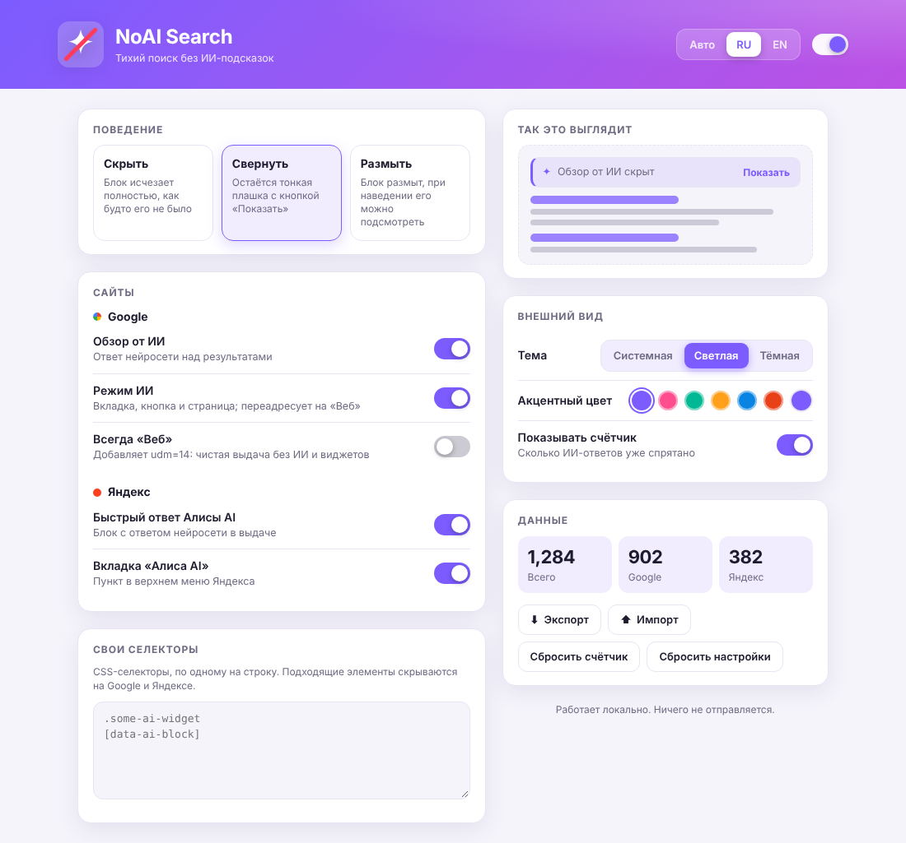
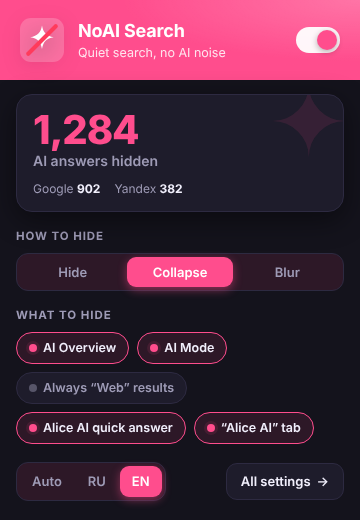

# NoAI Search

**RU** · [EN](#english)

Расширение для Chrome (Manifest V3), которое прячет ИИ-блоки в выдаче Google и Яндекса.



## Что скрывается

| Сайт | Блок |
|---|---|
| Google | «Обзор от ИИ» (AI Overview), вкладка и кнопка «Режим ИИ», страница режима ИИ (редирект на «Веб») |
| Яндекс | «Быстрый ответ Алисы AI» в выдаче, вкладка «Алиса AI» в шапке |

## Установка

1. Скачайте и распакуйте архив (или клонируйте папку).
2. Откройте `chrome://extensions` и включите «Режим разработчика».
3. Нажмите «Загрузить распакованное расширение» и выберите папку с `manifest.json`.
4. Закрепите значок расширения на панели — через него открывается popup.

Подходит для Chrome, Edge, Brave, Yandex Browser и других браузеров на Chromium.

## Возможности

- **Три режима:** скрыть полностью; свернуть до плашки с кнопкой «Показать»; размыть (размытие снимается при наведении).
- **Отдельные переключатели** для каждого блока Google и Яндекса.
- **«Всегда Веб»:** добавляет `udm=14` к запросам Google — выдача без ИИ и виджетов. Выключено по умолчанию.
- **Свои селекторы:** CSS-селекторы по одному на строку скрывают любые элементы на обоих сайтах.
- **Счётчик** скрытых ответов (отдельно Google и Яндекс).
- **Интерфейс:** светлая, тёмная или системная тема, 6 акцентных цветов и свой цвет.
- **Два языка:** русский и английский, переключаются на лету; «Авто» берёт язык браузера.
- **Экспорт и импорт** настроек в JSON.

Настройки синхронизируются через аккаунт браузера (`chrome.storage.sync`), счётчик хранится локально.

## Как это устроено

- **Яндекс:** ИИ-блоки помечены классами `Futuris*`, поэтому достаточно CSS (`li.serp-item:has([class*="FuturisSearch"])`) плюс скрипт для плашки и счётчика.
- **Google:** классы обфусцированы и меняются, поэтому скрипт ищет блок по заголовку («Обзор от ИИ», «AI Overview» и ещё ~10 языков) и скрывает контейнер вокруг него. Если внутрь контейнера попали обычные результаты, область автоматически сужается.
- Управление идёт через атрибуты на `<html>` (`data-noai`, `data-noai-mode`, `data-noai-flags`), поэтому настройки применяются мгновенно, без перезагрузки страницы.

## Приватность

Расширение работает только локально. Единственное разрешение — `storage`. Никакие данные не отправляются.

## Структура

```
manifest.json      манифест
shared.js          настройки по умолчанию, переводы
content.js/.css    поиск и скрытие блоков на страницах
popup.*            быстрое окно
options.*          страница настроек
ui.js/.css         общие стили и логика интерфейса
icons/             иконки
```

## Если перестало работать

Google и Яндекс иногда меняют разметку. Что поправить:

- Google не находит блок: добавьте заголовок на своём языке в `AI_HEAD` в `content.js`.
- Яндекс: проверьте классы в `content.css` и `sweepYandex()` в `content.js`.
- Не хватает домена: добавьте его в `matches` в `manifest.json`.
- Временное решение без правки кода: свои селекторы на странице настроек или «Всегда Веб».

---

## English

A Chrome (Manifest V3) extension that hides AI answers in Google and Yandex search results.



### What it hides

| Site | Block |
|---|---|
| Google | AI Overview, the AI Mode tab and button, the AI Mode page (redirects to “Web”) |
| Yandex | Alice AI quick answer in results, the “Alice AI” tab in the header |

### Install

1. Download and unzip the archive (or clone the folder).
2. Open `chrome://extensions` and enable Developer mode.
3. Click “Load unpacked” and select the folder containing `manifest.json`.
4. Pin the extension icon to open the popup.

Works in Chrome, Edge, Brave, Yandex Browser and other Chromium-based browsers.

### Features

- **Three modes:** hide completely; collapse into a bar with a “Show” button; blur (hover to peek).
- **Per-block toggles** for every Google and Yandex block.
- **Always “Web”:** appends `udm=14` to Google queries for results with no AI or widgets. Off by default.
- **Custom selectors:** CSS selectors, one per line, hide any element on both sites.
- **Counter** of hidden answers (Google and Yandex separately).
- **Interface:** light, dark or system theme, 6 accent colors plus a custom one.
- **Two languages:** Russian and English, switchable live; “Auto” follows the browser language.
- **Export and import** of settings as JSON.

Settings sync through your browser account (`chrome.storage.sync`); the counter is stored locally.

### How it works

- **Yandex:** AI blocks carry `Futuris*` classes, so CSS (`li.serp-item:has([class*="FuturisSearch"])`) does most of the work, with a script for the placeholder and counter.
- **Google:** class names are obfuscated and change often, so the script finds the block by its heading (“AI Overview” and about 10 other languages) and hides the container around it. If organic results end up inside the container, the scope narrows automatically.
- Everything is driven by attributes on `<html>` (`data-noai`, `data-noai-mode`, `data-noai-flags`), so settings apply instantly without a page reload.

### Privacy

Runs locally only. The sole permission is `storage`. No data is sent anywhere.

### If it stops working

Google and Yandex occasionally change their markup:

- Google block not found: add the heading in your language to `AI_HEAD` in `content.js`.
- Yandex: check the classes in `content.css` and `sweepYandex()` in `content.js`.
- Missing domain: add it to `matches` in `manifest.json`.
- Quick workaround without code changes: custom selectors in the settings page, or “Always Web”.
